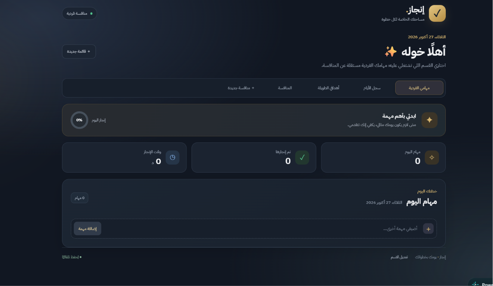
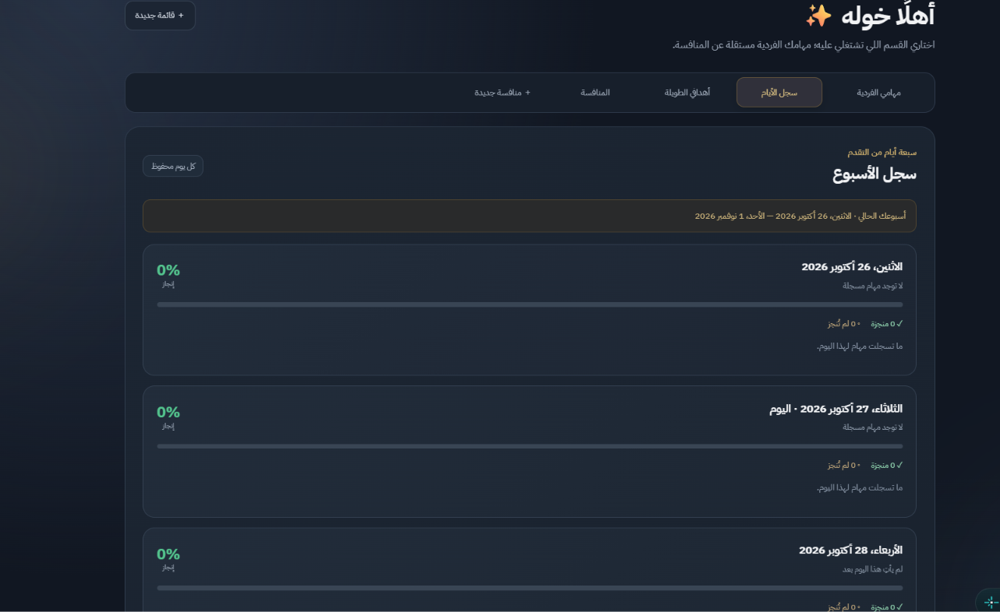
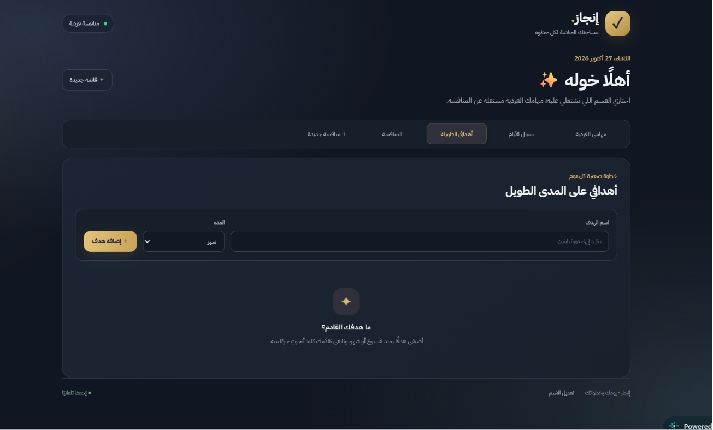
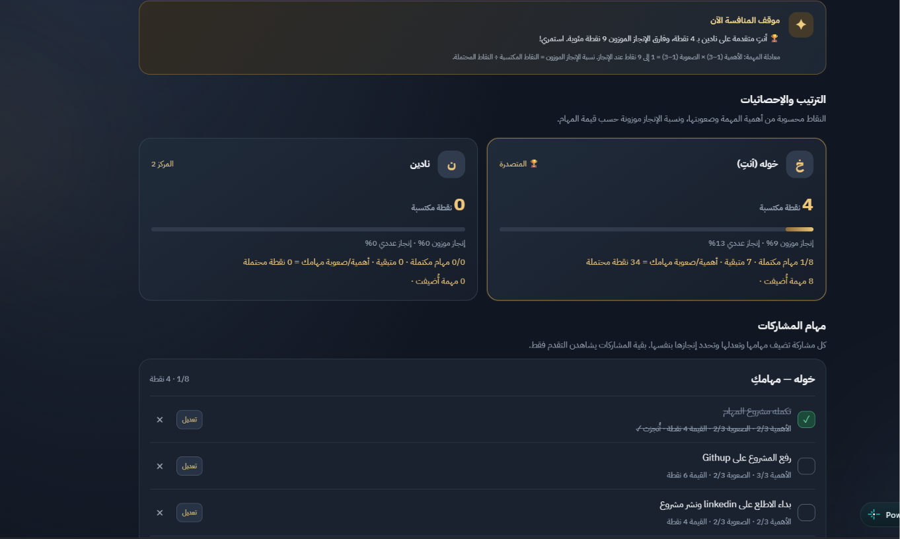
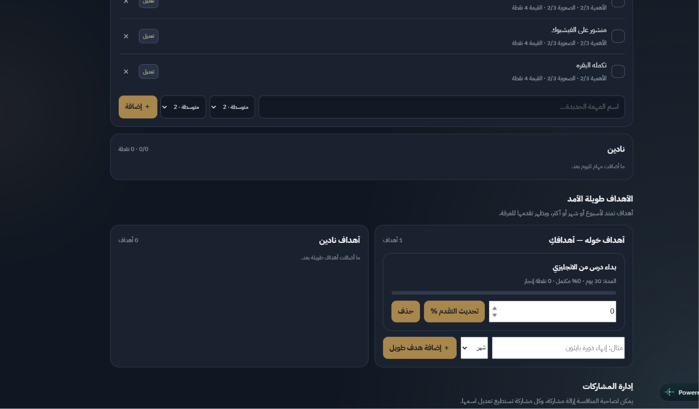
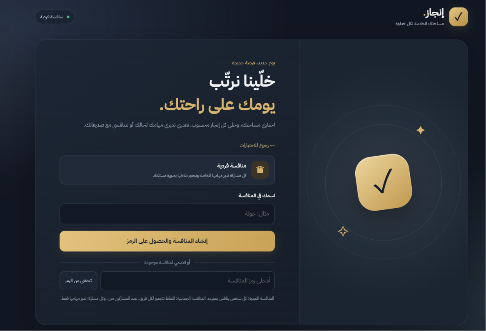

# 🚀 تطبيق إنجاز | Enjaz App

> **منصة عربية لإدارة المهام وبناء عادات الإنجاز من خلال التحديات والمنافسة الإيجابية.**  
> *An Arabic-first task management and friendly challenge platform powered by Supabase.*

## 📌 نبذة عن المشروع | About The Project

**إنجاز (Enjaz App)** هو تطبيق إنتاجية يستخدم أسلوب التلعيب (Gamification) لمساعدة المستخدمين على تنظيم مهامهم، متابعة تقدمهم، والاستمرار في تحقيق أهدافهم اليومية والطويلة الأمد.

يحتوي التطبيق على مساحتين مستقلتين:

- **المهام الفردية:** لإدارة المهام الشخصية والأهداف وسجل الإنجاز الخاص بالمستخدم.
- **المنافسات:** لإنشاء منافسة فردية بين المشاركين أو منافسة جماعية تضم فريقين أو أكثر. تنضم المشاركات إلى الغرفة باستخدام رمز خاص، وتدير كل مشاركة مهامها وأهدافها، بينما تظهر المقارنة والترتيب ضمن لوحة المنافسة.

لا يعتمد التقييم على عدد المهام فقط؛ فلكل مهمة درجة **أهمية** ودرجة **صعوبة** يختارهما المستخدم، وتُحسب النقاط وفق معادلة واضحة.

## ✨ أبرز المميزات | Key Features

- واجهة عربية من اليمين إلى اليسار (RTL)، متجاوبة مع شاشات اللابتوب والجوال.
- فصل المهام الفردية عن مهام المنافسة حتى لا تختلط النتائج بين المساحتين.
- إنشاء منافسات فردية مرنة من حيث عدد المشاركات، ومنافسات جماعية بفرق قابلة للتحديد.
- الانضمام إلى المنافسة عبر رمز الغرفة، مع إمكانية نسخ الرمز ومشاركته.
- إضافة مهام المنافسة وتعديلها وحذفها وتحديد حالتها كمكتملة أو غير مكتملة.
- تحديد أهمية المهمة وصعوبتها على مقياس من 1 إلى 3 لكل منهما.
- إحصائيات تشمل عدد المهام، المكتمل والمتبقي، النقاط المكتسبة والمحتملة، ونسبة الإنجاز.
- ترتيب المشاركات في المنافسة الفردية، وتجميع نقاط المشاركات حسب الفرق في منافسات الفرق.
- أهداف طويلة الأمد ومتابعة مستوى التقدم فيها.
- رسائل تحفيزية تتغير تبعًا لحالة التقدم والترتيب.
- سجل لأيام المنافسة يحتفظ بآخر سبعة أيام، مع ملخص للأسبوع السابق.
- إدارة اسم المشاركة، وإزالة المشاركات أو تغيير فرقهن من قبل صاحبة الغرفة وفق صلاحيات التطبيق.

## ⚖️ طريقة احتساب النقاط | Scoring System

تُحسب قيمة المهمة المحتملة بالمعادلة التالية:

**قيمة المهمة = الأهمية × الصعوبة**

كل من الأهمية والصعوبة يأخذ قيمة من **1 إلى 3**؛ لذلك تكون قيمة المهمة بين **1 و9 نقاط**. تُضاف هذه النقاط إلى الرصيد عند إنجاز المهمة. وتُحسب نسبة الإنجاز الموزون من مجموع النقاط المكتسبة مقارنةً بمجموع النقاط المحتملة للمهام المسجلة.

هذا التقييم **محدد وواضح وليس تقييمًا تلقائيًا بالذكاء الاصطناعي**؛ إذ تختار المشاركة مستوى الأهمية والصعوبة عند إضافة المهمة أو تعديلها.

## 📱 جولة في واجهات التطبيق | App Screens Walkthrough

#### 🔹 الشاشة الأولى (r1): اختيار نمط التنافس
* **الوصف:** شاشة البداية التي تتيح الانتقال إلى المهام الفردية، أو إنشاء منافسة فردية، أو بدء منافسة جماعية بالفرق.

  

#### 🔹 الشاشة الثانية (r2): إعداد التحدي وإدارة المشتركين
* **الوصف:** واجهة إعداد المنافسة، وإدخال الاسم، وإنشاء رمز غرفة لمشاركته مع الآخرين. في منافسات الفرق يمكن إعداد أسماء فريقين أو أكثر واختيار الفريق عند الانضمام.

  

#### 🔹 الشاشة الثالثة (r3): تسجيل المهام وتحديد قوتها
* **الوصف:** تضيف كل مشاركة مهامها الخاصة وتحدد الأهمية والصعوبة من 1 إلى 3. وتُحسب النقاط الممكنة من حاصل ضرب القيمتين، بحد أقصى 9 نقاط للمهمة المكتملة.

  

#### 🔹 الشاشة الرابعة (r4): المقارنة التفاعلية والتحفيز
* **الوصف:** تعرض لوحة المنافسة ترتيب المشاركات أو الفرق، وفروق الأداء، ورسائل تحفيزية تعتمد على البيانات الحالية داخل المنافسة.

  

#### 🔹 الشاشة الخامسة (r5): متابعة الإنجاز والإحصائيات
* **الوصف:** مؤشرات لمتابعة المهام المكتملة والمتبقية، والنقاط المكتسبة والمحتملة، ونسبة الإنجاز لكل مشاركة. تُحدَّث حالة المنافسة دوريًا أثناء الاتصال بالإنترنت.

  

#### 🔹 الشاشة السادسة (r6): لوحة الصدارة وسجل النتائج
* **الوصف:** تعرض لوحة الصدارة ترتيب المشاركات أو الفرق، مع سجل الأيام السابقة وملخص أسبوعي للتقدم والمهام المنجزة.

  

## 🛠️ التقنيات المستخدمة | Tech Stack

- **الواجهة الأمامية:** HTML5 وCSS3 وJavaScript (Vanilla JS).
- **قاعدة البيانات والوظائف الخلفية:** Supabase وPostgreSQL، مع وظائف قاعدة بيانات لإدارة غرف المنافسة وحفظ بيانات المشاركة.
- **تسجيل الدخول:** جلسة Supabase مجهولة لتحديد هوية المشاركة في المنافسة، دون اشتراط بريد إلكتروني في تدفق الاستخدام الحالي.
- **صلاحيات الوصول:** سياسات Row Level Security (RLS) ووظائف قاعدة البيانات للتحكم في قراءة بيانات المنافسة وتعديلها.
- **تحديث بيانات المنافسة:** يستعلم التطبيق عن حالة الغرفة دوريًا كل 4 ثوانٍ تقريبًا؛ **الإصدار الحالي لا يستخدم Supabase Realtime Channels**.
- **الاستضافة:** يمكن نشر ملفات الواجهة الثابتة عبر Netlify أو خدمة استضافة مشابهة.

## 💾 أين تُحفظ البيانات؟ | Data Storage

- بيانات **المهام الفردية** وسجلها المحلي تُحفظ في تخزين المتصفح (localStorage) على الجهاز والمتصفح المستخدمين؛ لذلك لا تنتقل تلقائيًا بين الأجهزة.
- بيانات **المنافسة المشتركة** تُحفظ في Supabase وتظهر للمشاركات المصرح لهن بالوصول إلى الغرفة.
- يلزم اتصال بالإنترنت للوصول إلى المنافسات المشتركة ومزامنة بياناتها.
- يجب عدم وضع مفاتيح `secret` أو `service_role` داخل ملفات الواجهة الأمامية. يُستخدم مفتاح `publishable` فقط مع إعداد سياسات الوصول الصحيحة.

## ⚙️ إعداد المشروع | Setup

1. نزّلي ملفات المشروع وفكّي ضغطها.
2. افتحي مجلد `enjaz-redesign` في محرر الأكواد أو جهزيه للنشر على الاستضافة.
3. في مشروع Supabase، فعّلي **Anonymous Sign-ins** من إعدادات Authentication.
4. إذا لم يتم إعداد قاعدة البيانات من قبل، شغّلي `supabase.sql` أولًا من **SQL Editor**.
5. شغّلي `migration-v2.sql` من **SQL Editor** لتجهيز وظائف إصدار V2. إذا نُفّذ ملف التأسيس من قبل بنجاح، فلا تعيدي تشغيله دون حاجة؛ اكتفي بالترقية.
6. تأكدي من أن رابط Supabase ومفتاح `publishable` مضبوطان في `app.js`، ولا تضعي أي مفتاح سري في الكود.
7. انشري محتويات مجلد `enjaz-redesign` على Netlify أو شغّلي الموقع عبر خادم محلي أثناء التطوير.
8. اختبري إنشاء منافسة من جهاز، ثم الانضمام إلى رمزها من جهاز آخر، وتحققي من حفظ المهام وتحديث النتائج.

## 🔒 الأمان والخصوصية | Security & Privacy

يستخدم التطبيق جلسات مجهولة للمشاركات وسياسات وصول ووظائف في Supabase لتقييد عمليات المنافسة. قبل إطلاق عام أو تجاري، يجب اختبار سياسات RLS وصلاحيات كل وظيفة، والتأكد من أن العضوة لا تستطيع قراءة أو تعديل بيانات غرفة لا تنتمي إليها. لا تضعي مفاتيح الخدمة السرية أو كلمات المرور في المستودع.

## 🚧 حالة المشروع | Project Status

**المشروع قيد التطوير النشط (Under Active Development).** تشمل النسخة الحالية واجهات المهام الفردية والمنافسات الفردية والجماعية، وحساب النقاط، والإحصائيات، وسجل الإنجاز.

تم فحص عدد من السيناريوهات محليًا باستخدام محاكاة لاستجابات Supabase. لكن يجب تشغيل `migration-v2.sql` على مشروع Supabase الفعلي واختبار المنافسة من جهازين مختلفين قبل اعتبار المزامنة السحابية جاهزة للإطلاق العام. تحديثات المنافسة في الإصدار الحالي دورية وليست عبر قنوات Supabase Realtime.

## 🗺️ خارطة الطريق | Roadmap

- اختبار شامل للمزامنة بين عدة أجهزة واتصالات متزامنة.
- مراجعة أمان شاملة لسياسات RLS ووظائف قاعدة البيانات.
- تحسين إدارة الحسابات الدائمة واستعادة الوصول إلى البيانات عند تغيير الجهاز.
- إضافة اختبارات آلية وتوثيق أوضح للمستخدمين.
- تقييم احتياجات المستخدمين قبل إضافة خطط اشتراك أو ميزات مدفوعة.

---

صُنع لتكون خطواتك أوضح، وإنجازك أقرب ✨

